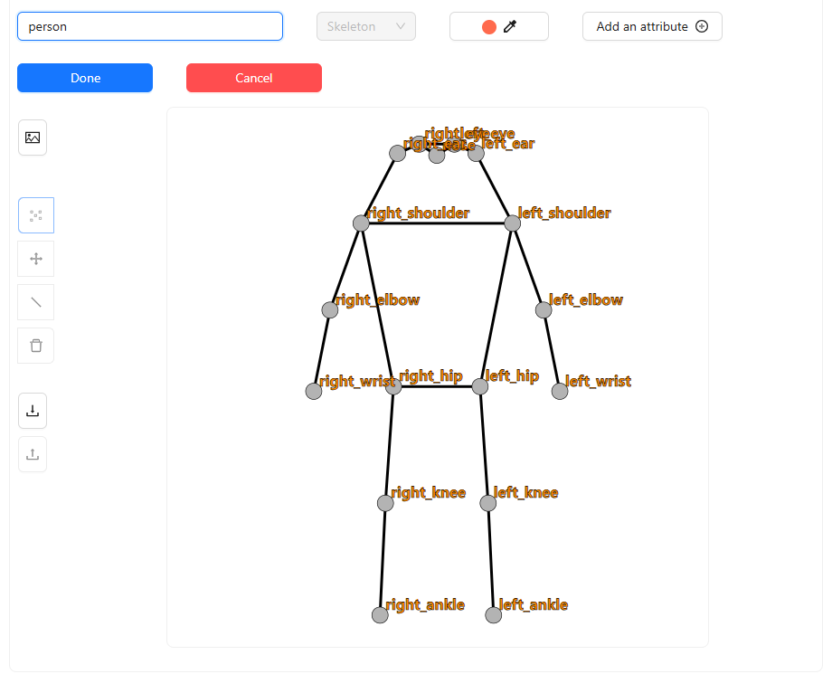
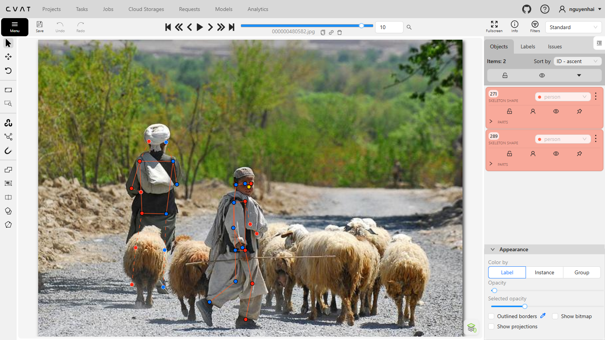
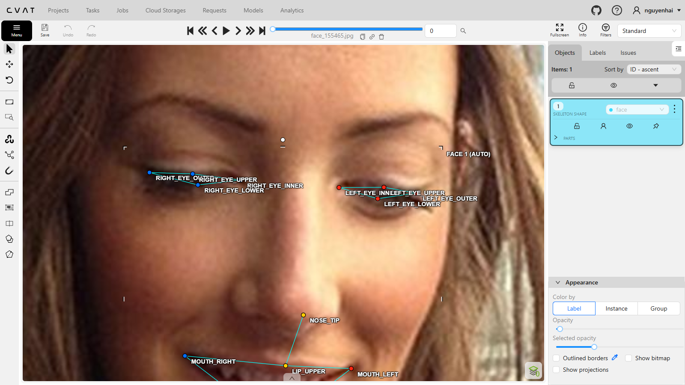
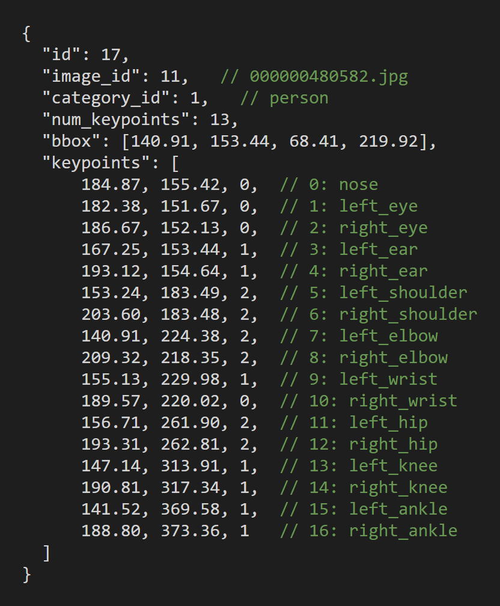

# Báo cáo cá nhân — HoVaTen-MSSV

Đổi tên file theo quy tắc `MSSV_HoTen.md`. Ví dụ: `20241234_NguyenVanAn.md`.

Dữ liệu: 12 ảnh người COCO val2017 (Lin et al., 2014) và 8 ảnh chân dung Wikimedia Commons, chỉ dùng trong lớp.

## 0. Thông tin học viên

- Họ tên: Nguyễn Minh Nam Hải
- MSSV: 2A202603076
- Email: 26ai.hainmn@vinuni.edu.vn
- Link repository: https://github.com/namhai923/K5-L2A-NGUYENMINHNAMHAI-2A202603076-KeypointPose-Student
- Phiên bản CVAT (Help → About): 2.74.1
- Máy: hệ điều hành Windows 11 Pro · RAM 15.8 GB · chạy CVAT chế độ đầy đủ
- Bộ ảnh (`src/exports/assignment.json` do `lab.py setup` tạo): có
- Giờ bắt đầu: 16:30
- Giờ kết thúc: 19:30

## 1. Kiểm tra label (CP0)

| Label | Kiểu | Số điểm | Tên điểm đúng bảng của lab? | Đúng thứ tự? | Số cạnh |
|---|---|---:|---|---|---:|
| `person` | Skeleton | 17 | Có | Có | 19 |
| `face` | Skeleton | 13 | Có | Có | 13 |

Mẫu `person` dựng theo người quay mặt về camera (các điểm `left_*` nằm bên phải khung mẫu)? **Có** (trong mẫu: `left_shoulder` x = 64, `right_shoulder` x = 36; `left_hip` x = 58, `right_hip` x = 42).

Cách đổi cờ `occluded` / `outside` cho **một điểm** trên phiên bản CVAT này (một câu): Rê chuột vào đúng điểm đó rồi bấm `Q` để bật/tắt `occluded` (v = 1) hoặc `O` để bật/tắt `outside` (v = 0); hoặc chuột phải vào điểm để mở menu có nút outside · khóa · occluded · hidden.

...

## 2. Số lượng đã gán và thời gian (CP1, CP2)

| Nhóm ảnh | Số ảnh | Số skeleton đã gán | Số người dưới 60 px (không gán) | Số poster / gương / màn hình bỏ qua | Thời gian (phút) |
|---|---:|---:|---:|---:|---:|
| `easy` | 5 | 5 | 0 | 0 | 5 |
| `occluded` | 3 | 6 | 0 | 0 | 10 |
| `back` | 2 | 4 | 1 | 0 | 5 |
| `small` | 1 | 2 | 1 | 0 | 5 |
| `crowd` | 1 | 3 | 0 | 0 | 5 |
| `faces` | 8 | 8 | — | 0 | 5 |

- Số ảnh người đã xong ở mốc phút 105: 12 / 10
- Thời gian thực tế (phút): CP1 ≈ 30 · CP2 ≈ 7 · CP3 ≈ 7
- Ảnh tốn thời gian nhất là ảnh nào, vì sao? 000000469061 (occluded): mẹ đứng sau bé, hai người chồng lên nhau. Model đặt sai chân của cả hai: gối và cổ chân của bé cao hơn thật khoảng 45 px, còn cổ chân của mẹ bị gán outside dù chân trái vẫn thấy. Phải phóng to từng vùng và đặt lại 8 điểm chân, và chọn giữa v = 1 / v = 0 cho chân phải của mẹ.

...

## 3. Bảng ca khó (CP1, CP2)

| Ảnh | Người / mặt | Điểm | Cờ đã chọn | Phân vân giữa | Lý do chọn |
|---|---|---|---:|---|---|
| 000000469061 | mẹ (đứng sau bé) | right_knee, right_ankle | 1 | v = 1 / v = 0 | Chân phải bị thân bé che, nhưng thấy một phần giày sau chân bé và biết vị trí hông, nên ước lượng chắc → occluded |
| 000000157271 | áo trắng | left_elbow | 1 | v = 1 / v = 0 | Khuỷu bị thân #17 che; thấy rõ vai và cổ tay, tay duỗi thẳng nên khuỷu nằm trên đường vai–cổ tay → occluded |
| 000000542160 | #4 (quay lưng) | left/right_knee, left/right_ankle | 2 | v = 2 / v = 1 | Hai chân khép, gối và cổ chân hai bên trùng chỗ; không chắc chân nào ở sau nên giữ v = 2 cho cả hai |
| 000000360811 | người nữ | right_wrist | 2 | v = 2 / v = 0 | Cổ tay ở x ≈ 4, sát mép trái; bàn tay cầm điện thoại thấy rõ nên cổ tay vẫn trong ảnh → v = 2 |
| 000000360811 | người nữ | left_ear, right_ear | 1 | v = 1 / v = 0 | Tóc dài che hai tai; vị trí tai suy được từ hai bên đầu, mắt, mũi → occluded |
| 000000480582 | người lớn quay lưng | nose, left_eye, right_eye | 0 | v = 1 / v = 0 | Quay lưng hẳn, không thấy mặt, không đoán chắc → outside (đúng bảng cờ mục 4) |
| 000000480582 | người lớn quay lưng | left_ear, right_ear | 1 | v = 2 / v = 1 | Khăn quấn che tai, không thấy viền tai nhưng vị trí tai chắc theo đầu → occluded |
| face_333134 | mặt tóc che | right_eye_* (4 điểm) | 1 | v = 2 / v = 1 | Vài lọn tóc vắt qua mắt phải; vẫn thấy mép mí qua kẽ tóc nhưng không rõ → occluded |
| face_449454 | mặt nghiêng | left_eye_* (4 điểm) | 2 | v = 2 / v = 1 | Mặt nghiêng và cười híp mắt; mắt trái vẫn thấy, sống mũi không che → v = 2 |
| face_416730 | mặt nghiêng | left_eye_inner, mouth_left | 2 | v = 2 / v = 1 | Khóe trong mắt trái gần sống mũi, khóe miệng trái gần điện thoại; cả hai vẫn thấy → v = 2 |

## 4. Bảng tự review (CP3)

| Ảnh | Người / mặt | Điểm | Mã lỗi | Ghi chú | Đã sửa? |
|---|---|---|---|---|---|
| 000000542160 (crowd) | #5 (giữa, quay mặt) | left/right_knee, left/right_ankle | `lr_swap` | Hông đúng nhưng gối và cổ chân trái nằm bên trái ảnh, hai chân bắt chéo; đổi tên hai cặp | có |
| 000000542160 (crowd) | #5 | right_shoulder | `vis_flag` | Bị tay #4 che, v = 2 → v = 1 | có |
| 000000480582 (back) | người lớn quay lưng | left_ear, right_ear | `vis_flag` | Khăn quấn che tai, v = 2 → v = 1 | có |
| 000000480582 (back) | người lớn quay lưng | left_knee, right_knee, left_ankle | `vis_flag` | Con cừu phía trước che chân, v = 2 → v = 1 | có |
| 000000480582 (back) | cậu bé | — | `ok` | Quay mặt, left/right đúng, cờ đúng | — |
| 000000469061 (occluded) | mẹ | left_knee, right_knee | `position` | Gối đặt ngang tầm hông (y ≈ 308), dời xuống y ≈ 385 | có |
| 000000469061 (occluded) | mẹ | left_ankle, right_ankle | `vis_flag` | Đang là outside dù thấy chân trái; left_ankle → v = 2, right_ankle → v = 1 (sau chân bé) | có |
| 000000469061 (occluded) | bé | left/right_knee, left/right_ankle | `position` | Cổ chân ở giữa ống quyển, lệch khoảng 45 px so với cổ giày; dời gối và cổ chân xuống | có |
| 000000360811 (occluded) | người nữ | left_ear, right_ear | `vis_flag` | Tóc che tai, v = 2 → v = 1 | có |
| 000000360811 (occluded) | người nữ | right_elbow | `vis_flag` | Điểm occluded nằm sát mép (x = 3), khuỷu thật ở ngoài ảnh → outside | có |
| 000000360811 (occluded) | người nam | left_hip, right_hip | `vis_flag` | Hông ở sau bàn ăn, v = 2 → v = 1 | có |
| 000000157271 (occluded) | áo trắng | left_wrist | `position` | Đặt nhầm trên quần của #17; tay thật cạnh đĩa, dời về (307, 156) | có |
| 000000157271 (occluded) | áo trắng | left_elbow | `vis_flag` | Khuỷu bị thân #17 che, v = 2 → v = 1, dời lên đường vai–cổ tay | có |
| 000000157271 (occluded) | #17 (quay lưng) | — | `ok` | left_* nằm bên trái ảnh, đúng với người quay lưng | — |
| face_504911 (kính trong) | mặt | — | `ok` | Mí lệch ≤ 3 px, cờ v = 2 đúng với kính trong | — |
| face_496353 (mặt thẳng) | mặt | lip_upper, lip_lower | `position` | Có thể nằm ở mép trong môi, lệch khoảng 7 px | chưa: cần phóng to xác nhận trước khi sửa |
| face_449454 (mặt nghiêng) | mặt | left_eye_upper, left_eye_lower | `position` | Mí trên đặt trên đốm sáng con ngươi, lệch khoảng 8 px; dời lên mép mí | có |

Tổng hợp số lỗi theo mã:

| `lr_swap` | `vis_flag` | `position` | `missing` | `extra` | `ok` |
|---:|---:|---:|---:|---:|---:|
| 1 | 8 | 5 | 0 | 0 | 3 |

Điểm còn phân vân giữa `v = 1` và `v = 0` (ghi cả hai lựa chọn và lý do chọn):

- 000000469061, mẹ, right_knee / right_ankle: chọn v = 1, bỏ v = 0. Chân phải bị bé che nhưng thấy một phần giày sau chân bé và biết vị trí hông, nên ước lượng chắc.
- 000000157271, áo trắng, left_elbow: chọn v = 1, bỏ v = 0. Vai và cổ tay thấy rõ, tay duỗi thẳng, nên khuỷu nằm chắc trên đường vai–cổ tay.
- 000000360811, người nữ, right_elbow: chọn v = 0, bỏ v = 1. Khuỷu ở ngoài mép trái ảnh; đặt v = 1 sát mép là điểm "cho có".
- 000000480582, người lớn quay lưng, nose / left_eye / right_eye: chọn v = 0, bỏ v = 1. Quay lưng hẳn, không thấy mặt, không đoán chắc vị trí.


...

## 5. Kiểm file xuất và kết quả tự kiểm (CP4)

Tự kiểm tay trong file JSON:

| File | Người / mặt kiểm (ảnh, thứ tự) | Số phần tử `keypoints` | Điểm `outside` ra `v = 0`, `occluded` ra `v = 1`? | `num_keypoints` khớp? |
|---|---|---|---|---|
| `NguyenMinhNamHai_persons.zip` | 000000480582.jpg, cậu bé (ann id 16) | 51 (17 × 3) | Có: left_ear outside → v = 0; left_elbow, left_wrist occluded → v = 1 | Có: 16 = số điểm v > 0 (16) |
| `NguyenMinhNamHai_persons.zip` | 000000360811.jpg, người nữ (ann id 11) | 51 (17 × 3) | Có: 6 điểm outside → v = 0 (right_elbow, right_hip, 2 gối, 2 cổ chân); 3 điểm occluded → v = 1 | Có: 11 = 11 |
| `NguyenMinhNamHai_faces.zip` | face_255797.jpg, mặt kính râm (ann id 2) | 39 (13 × 3) | Có: 8 điểm mắt occluded → v = 1; không có điểm outside | Có: 13 = 13 |

Sau khi xuất, CVAT ghi `occluded` thành `v = **1**` và outside thành `v = **0**`. Tọa độ của điểm `outside` trong file là `**tọa độ cũ**`, không phải `0, 0`

Hai job đã chuyển sang completed trên CVAT? Có

Dán phần **TÓM TẮT** in ra từ `src/check_submission.py`:

```text
----- TÓM TẮT (dán vào báo cáo mục 5) -----
- File person: NguyenMinhNamHai_persons.zip
  Số ảnh: 12 · số skeleton `person`: 20 · mỗi annotation 51 số
  Skeleton theo ảnh: 000000043500=2, 000000072098=1, 000000100510=2, 000000157271=2, 000000205650=1, 000000240340=1, 000000349521=1, 000000360811=2, 000000433787=1, 000000469061=2, 00000048
0582=2, 000000542160=3
  Cờ v: v=2 276 (81%) · v=1 27 (8%) · v=0 37 (11%)
  num_keypoints trung bình: 15.2
- File face: NguyenMinhNamHai_faces.zip
  Số ảnh: 8 · số skeleton `face`: 8 · mỗi annotation 39 số
  Skeleton theo ảnh: face_155465=1, face_255797=1, face_257657=1, face_333134=1, face_416730=1, face_449454=1, face_496353=1, face_504911=1
  Cờ v: v=2 92 (88%) · v=1 12 (12%) · v=0 0 (0%)
  num_keypoints trung bình: 13.0
- Ghi chú: 37 điểm v = 0 vẫn mang tọa độ cũ (CVAT 2.x xuất như vậy; chuẩn COCO ghi 0, 0). Không phải lỗi: điểm v = 0 bị bỏ qua khi huấn luyện và khi chấm.
- Số [LỖI]: 0 · số [CẢNH BÁO]: 0
Kết quả: ĐẠT
```

Các `[CẢNH BÁO]` còn giữ nguyên và lý do:

...

## 6. Ảnh chụp màn hình

1. Label `person` trong label constructor (đủ 17 điểm có tên):

   

2. Một người quay lưng đã gán, cờ đã đặt:

   

3. Một khuôn mặt đã gán 13 điểm, phóng to vùng mắt:

   

4. Một đoạn JSON xuất của một người:

   

Nguồn ảnh: COCO val2017 / Wikimedia Commons.

## 7. Tự đánh giá

1. Lỗi bạn mắc nhiều nhất hôm nay, và cách bạn sẽ tránh ở dự án thật:

      Lỗi nhiều nhất là `vis_flag` (8 / 14 lỗi trong bảng tự review). Nguyên nhân: nhãn được tạo sẵn bằng model, và cờ được suy từ độ tin cậy của model. Model vẫn tự tin ở những điểm bị che: tai dưới khăn quấn hoặc dưới tóc, hông sau bàn ăn, chân sau con cừu. Vì vậy các điểm đó bị gán v = 2 thay vì v = 1. Ở dự án thật, tôi sẽ không dùng độ tin cậy của model làm cờ. Sau khi đặt xong một người, tôi rà riêng từng điểm theo bốn câu hỏi ở mục 4 của guideline, và rà kỹ nhất chỗ có vật hoặc người khác chồng lên.


2. Một quy tắc bạn đề xuất thêm vào guideline (kèm ảnh ví dụ nếu có):

      "Khớp bị khăn, mũ, tóc hoặc quần áo rộng che hoàn toàn (tai dưới khăn quấn, tai dưới tóc dài) là `occluded` (v = 1) nếu vị trí suy chắc được từ đầu và các điểm mặt; chỉ là v = 2 khi thấy được viền tai." Ví dụ: ảnh 000000480582, người lớn quay lưng đội khăn quấn (xem ảnh 2 ở mục 6).


3. Nhãn của bạn đi vào model ở đâu? Chọn một lỗi bạn đã sửa và nói nó sẽ làm model học sai thế nào (heatmap, trọng số trong loss, hay bước lật ảnh):

      Lỗi `lr_swap` ở ảnh 000000542160, cầu thủ #5: hông đúng nhưng gối và cổ chân hai bên bị đổi tên. Mỗi điểm v > 0 thành một đỉnh heatmap theo đúng tên của nó, nên model sẽ học đặt đỉnh `left_knee` vào gối phải và ngược lại, với trọng số 1 trong loss. Ở bước lật ảnh khi huấn luyện, cặp `left_*` ↔ `right_*` được đổi tên. Nhãn đã sai sẵn nên sau khi lật vẫn sai, và còn mâu thuẫn với nhãn của những người khác trong cùng tập. Model nhận tín hiệu ngược nhau cho cùng một kiểu chân, nên dự đoán trái/phải ở chân sẽ dao động. Khi đánh giá, điểm nằm đúng khớp nhưng sai tên vẫn có khoảng cách lớn tới ground truth, nên OKS của người đó sụp dù hình dáng skeleton nhìn đúng.


## 8. Khó khăn và lỗi kỹ thuật

...

## Bonus (nếu làm)

### B1 — 3 ảnh người khó thêm

| Ảnh | Số skeleton | Số người dưới 60 px | Ca khó nhất |
|---|---:|---:|---|
| | | | |
| | | | |
| | | | |

Kết quả `src/check_submission.py` cho `HoVaTen_bonus_persons.zip`:

```text
(dán ở đây)
```

### B2 — 5 ảnh khuôn mặt đen trắng / hồng ngoại

Ảnh không màu khó hơn ở điểm nào? Kính râm trên ảnh hồng ngoại có còn là `v = 1` không?

...

### B3 — Model so với nhãn của tôi (không tính điểm)

- Demo đã dùng:
- Ảnh đã thử:

1. Model có trả điểm cho khớp bị che, hay khớp ngoài ảnh không? Confidence ở các điểm đó thế nào?

   ...

2. Với người quay lưng, model có đổi trái/phải không?

   ...

3. Bộ điểm của model có giống 17 điểm COCO không?

   ...

## 9. Tài liệu tham khảo và công cụ AI đã dùng

...
